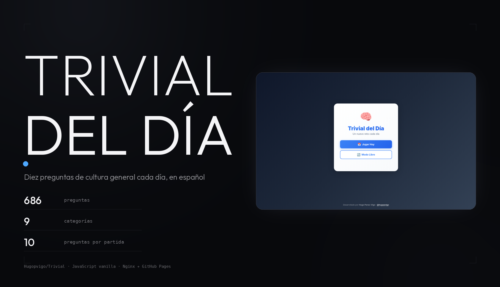
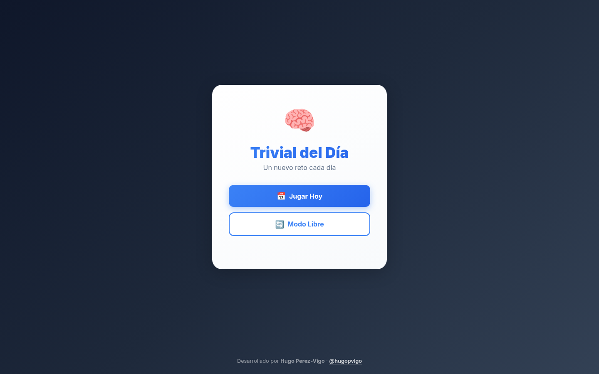

<meta property="og:title" content="TRIVIAL">
<meta property="og:description" content="Un trivial diario de cultura general en español, con 686 preguntas y nueve categorías.">
<meta property="og:image" content="https://raw.githubusercontent.com/Hugopvigo/Trivial/main/docs/capturas/og.png">

<p align="center">
  
</p>

<p align="center">
  <b>Un trivial diario de cultura general en español, con 686 preguntas y nueve categorías.</b><br>
  La partida del día es la misma para todo el mundo; el modo libre, todo lo que quieras.
</p>

<p align="center">
  <a href="https://trivial.hugoperezvigo.es/"></a>
  
  
  
</p>

---

## Qué es esto

Un trivial de cultura general que se juega en el navegador, sin cuentas ni
servidor: diez preguntas, cuatro opciones y un marcador al final.

- **Modo Diario** — una partida por día, con las mismas preguntas para todo el
  mundo. La semilla sale de la fecha, así que el reto es el mismo el 21 de
  octubre que dentro de un mes.
- **Modo Libre** — partidas de 10 preguntas elegidas al azar, todas las veces
  que quieras.
- **Estadísticas** — partidas jugadas, racha actual, mejor racha y porcentaje
  de acierto, guardadas en el navegador (`localStorage`). Las cuenta la
  partida del día: la racha sube cuando se aciertan **6 de 10** o más, y se
  reinicia con cualquier resultado inferior.
- **Resultado para compartir** — una fila de 🟩🟥 por pregunta, al estilo
  Wordle, lista para copiar y pegar.


*La portada: **Jugar Hoy** para la partida del día y **Modo Libre** para practicar.*

<p align="center">
  
</p>

<p align="center"><sub>Una partida en modo libre: se contesta, la app corrige y pasa a la siguiente. Es el juego de verdad, en su web.</sub></p>

## Las preguntas

**686 preguntas** repartidas en **9 categorías**:

| Categoría | Preguntas |
|---|---|
| Geografía | 153 |
| Cine y Música | 83 |
| Tecnología | 84 |
| Arte y Literatura | 65 |
| Naturaleza | 65 |
| Historia | 63 |
| Ciencia | 62 |
| Deportes | 61 |
| Gastronomía | 50 |

Cada partida son **10 preguntas** y se muestran **4 opciones** por pregunta,
con la correcta barajada de sitio.

## Cómo se juega

1. Pulsa **Jugar Hoy**. Si ya jugaste la partida de hoy, se abre directamente
   el resultado guardado.
2. Elige una opción: el botón se pone verde si aciertas, rojo si fallas, y
   sale un aviso con el resultado.
3. Al terminar, el marcador muestra la puntuación, las estadísticas
   acumuladas y el emoji para compartir.

## Ponerlo en marcha

No hay dependencias: son cuatro ficheros estáticos.

```bash
git clone https://github.com/Hugopvigo/Trivial.git
cd Trivial
python3 -m http.server 8000
# → http://localhost:8000
```

### Con Docker

El repositorio trae un `Dockerfile` (nginx:alpine) y un `docker-compose.yml`
que sirve el juego en el puerto 8082:

```bash
docker compose up -d
# → http://localhost:8082
```

El contenedor sirve `index.html`, `style.css`, `script.js`, `data.js`,
`robots.txt` y `sitemap.xml`.

## Estructura

```
Trivial/
├── index.html          ← las tres pantallas: portada, partida y resultado
├── style.css
├── script.js           ← lógica del juego, estadísticas y compartir
├── data.js             ← las 686 preguntas
├── Dockerfile          ← nginx:alpine
├── docker-compose.yml  # puerto 8082
├── robots.txt
├── sitemap.xml
└── docs/capturas/
```

## Despliegue

El sitio está publicado en GitHub Pages y también en su propio dominio:

- <https://hugopvigo.github.io/Trivial/>
- <https://trivial.hugoperezvigo.es/>

## Licencia

**CC0 1.0 Universal** (dominio público). Se puede copiar, modificar y
distribuir sin pedir permiso. Ver [LICENSE](LICENSE).
